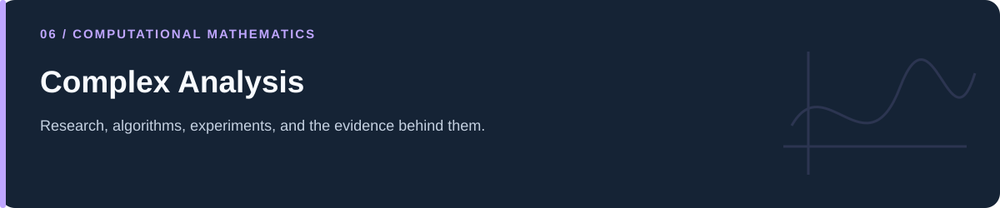

# Complex Analysis

**Series tests, branch cuts, and sequences of functions in computational form.**

[Portfolio](../README.md) · [Evidence & results](../docs/PROJECT_EVIDENCE.md) · [2026 repairs](../docs/REPAIRS.md) · [Reproduction](../docs/REPRODUCIBILITY.md) · [Full code catalog](../docs/CODE_CATALOG.md)

---

## At a glance

| Item | Description |
|---|---|
| Collection | Complex Analysis |
| Subject source inventory | 24 Python · 0 R · 0 notebooks |
| Verification level | Source inspection, selected saved artifacts, and focused regressions described in the repair log. |

## Scope and interpretation

Discrete plots illustrate selected examples. A mesh, a partial sum, or numerically located roots cannot establish a general convergence or differentiability theorem. Several zeta-related variants are also represented in the separate zero-statistics collection.

## Project and study guides

| Guide | Question |
|---|---|
| [Series Convergence Diagnostics](Advanced%20Series%20Convergence%20Tests/README.md) | What do ratio, root, Raabe, Dirichlet, and Kummer examples look like numerically? |
| [Complex Domains and Branch Cuts](Differentiability/README.md) | Where do chosen complex-function branches exclude points? |
| [Sequences, Series, and Zeta Experiments](Sequence%20and%20Series%20of%20Function/Sequence%20and%20Series%20of%20Function/README.md) | How can convergence and complex-function behavior be visualized? |

## Reading and execution

Start with the guide matching your question, inspect its parameters and inputs, then follow links to source. The order is an explanatory reading path; it is not a guarantee that every script executes consecutively.

Read [the reproduction guide](../docs/REPRODUCIBILITY.md) before running code. Source files can load external data, contact services, write artifacts, run large searches, or control hardware. The focused validation suite does not reproduce all historical experiments.

---

[Portfolio](../README.md) · [Evidence & results](../docs/PROJECT_EVIDENCE.md) · [2026 repairs](../docs/REPAIRS.md) · [Reproduction](../docs/REPRODUCIBILITY.md) · [Full code catalog](../docs/CODE_CATALOG.md)
