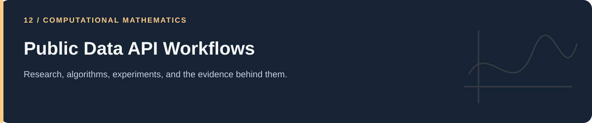

# Public Data API Workflows

**Historical Korean COVID-19 collection, grouping, and data correction scripts.**

[Portfolio](../README.md) · [Evidence & results](../docs/PROJECT_EVIDENCE.md) · [2026 repairs](../docs/REPAIRS.md) · [Reproduction](../docs/REPRODUCIBILITY.md) · [Full code catalog](../docs/CODE_CATALOG.md)

---

## At a glance

| Item | Description |
|---|---|
| Collection | Public Data API Workflows |
| Subject source inventory | 7 Python · 0 R · 0 notebooks |
| Verification level | Source inspection, selected saved artifacts, and focused regressions described in the repair log. |

## Scope and interpretation

The code refers to data.go.kr/KDCA interfaces and historical snapshots. Endpoint availability, completeness, response schema, and data redistribution conditions require review before new collection. No current API requests were made for this documentation/repair task.

## Project and study guides

| Guide | Question |
|---|---|
| [KDCA Historical Data Collection](Korea%20Open%20Data%20Portal/Data%20-%20Korea%20Disease%20Control%20and%20Prevention%20Agency%20%28KDCA%29/README.md) | How are historical COVID-19 API responses retrieved and organized? |

## Reading and execution

Start with the guide matching your question, inspect its parameters and inputs, then follow links to source. The order is an explanatory reading path; it is not a guarantee that every script executes consecutively.

Read [the reproduction guide](../docs/REPRODUCIBILITY.md) before running code. Source files can load external data, contact services, write artifacts, run large searches, or control hardware. The focused validation suite does not reproduce all historical experiments.

---

[Portfolio](../README.md) · [Evidence & results](../docs/PROJECT_EVIDENCE.md) · [2026 repairs](../docs/REPAIRS.md) · [Reproduction](../docs/REPRODUCIBILITY.md) · [Full code catalog](../docs/CODE_CATALOG.md)
