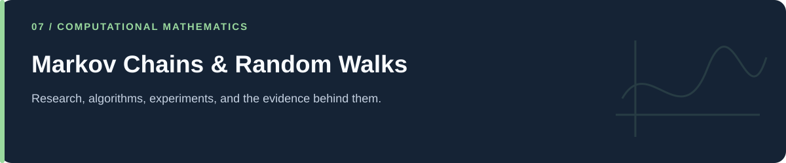

# Markov Chains & Random Walks

**Transition sampling, Monte Carlo experiments, and animated paths.**

[Portfolio](../README.md) · [Evidence & results](../docs/PROJECT_EVIDENCE.md) · [2026 repairs](../docs/REPAIRS.md) · [Reproduction](../docs/REPRODUCIBILITY.md) · [Full code catalog](../docs/CODE_CATALOG.md)

---

## At a glance

| Item | Description |
|---|---|
| Collection | Markov Chains & Random Walks |
| Subject source inventory | 18 Python · 0 R · 0 notebooks |
| Verification level | Source inspection, selected saved artifacts, and focused regressions described in the repair log. |

## Scope and interpretation

Some files called Brownian motion implement finite discrete random walks. Random seeds are not uniformly fixed in the historical scripts. Stochastic lightning paths are illustrative and should be distinguished from the electric-potential PDE collection.

## Project and study guides

| Guide | Question |
|---|---|
| [Simple Markov Chain Examples](Simple%20examples%20Markov%20chaine/README.md) | How is a path generated from a state distribution and transition matrix? |
| [Random Walk and Monte Carlo Visualizations](Brownian%20Motion%20Modeling/README.md) | How do sampled increments accumulate into paths and endpoint distributions? |
| [Stochastic Lightning-Like Paths](Lightning%20modeling%20Modeling/README.md) | How can constrained random motion create a branching/path illustration? |

## Reading and execution

Start with the guide matching your question, inspect its parameters and inputs, then follow links to source. The order is an explanatory reading path; it is not a guarantee that every script executes consecutively.

Read [the reproduction guide](../docs/REPRODUCIBILITY.md) before running code. Source files can load external data, contact services, write artifacts, run large searches, or control hardware. The focused validation suite does not reproduce all historical experiments.

---

[Portfolio](../README.md) · [Evidence & results](../docs/PROJECT_EVIDENCE.md) · [2026 repairs](../docs/REPAIRS.md) · [Reproduction](../docs/REPRODUCIBILITY.md) · [Full code catalog](../docs/CODE_CATALOG.md)
