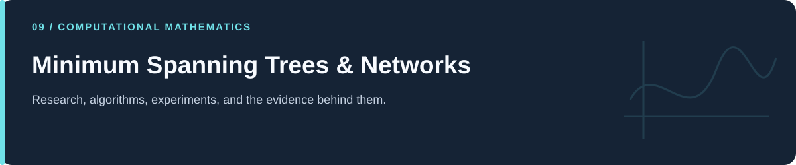
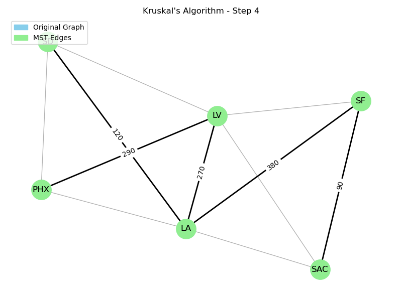

# Minimum Spanning Trees & Networks

**Road-cost examples, graph algorithms, and exploratory trade networks.**

[Portfolio](../README.md) · [Evidence & results](../docs/PROJECT_EVIDENCE.md) · [2026 repairs](../docs/REPAIRS.md) · [Reproduction](../docs/REPRODUCIBILITY.md) · [Full code catalog](../docs/CODE_CATALOG.md)

---

## At a glance

| Item | Description |
|---|---|
| Collection | Minimum Spanning Trees & Networks |
| Subject source inventory | 6 Python · 0 R · 0 notebooks |
| Verification level | Source inspection, selected saved artifacts, and focused regressions described in the repair log. |

## Scope and interpretation

The road costs are illustrative. Trade graphs use reciprocal volume as a chosen edge cost, not a calibrated transport-cost model or a causal estimate of tariffs. Directional trade entries are inserted into an undirected Graph, requiring an explicit aggregation rule before further economic interpretation.

## From an illustrative road network to a trade graph

The first example specifies six city labels and weighted connections, calls Kruskal's minimum-spanning-tree algorithm, and prints the chosen-edge total. Further variants save intermediate Prim/Kruskal frames and animations.

The trade experiments load a 19×19 matrix labeled as 2022 exports and choose edge cost **1/trade_volume**. A scenario applies a fixed multiplicative reduction to US-connected volumes before recalculating the tree. This parameter is a hypothetical reduction, not a measured tariff effect.

| Layer | Meaning |
|---|---|
| Road weights | Illustrative construction costs assigned in the code. |
| Trade weights | Reciprocal volumes, chosen to favor large-volume connections. |
| Graph representation | Undirected `networkx.Graph`; reverse-direction insertions can replace an existing edge. |
| Algorithm | An MST minimizes the supplied edge weights; disconnected inputs yield a forest. |

The API behavior is described in the [NetworkX MST reference](https://networkx.org/documentation/stable/reference/algorithms/generated/networkx.algorithms.tree.mst.minimum_spanning_tree.html). Whether a tree is a useful economic summary is a separate modeling judgment.

## Source guide

| Source | What to inspect |
|---|---|
| [(1.1)Optimizing a Transportation Network.py](%281.1%29Optimizing%20a%20Transportation%20Network.py) | Top-level experiment; imports: matplotlib.pyplot, networkx |
| [(1.2)Optimizing a Transportation Network(with pngs).py](%281.2%29Optimizing%20a%20Transportation%20Network%28with%20pngs%29.py) | Defined helpers: `save_kruskal_frames`, `save_prim_frames`, `play_frames` |
| [(1.3)Optimizing a Transportation Network(with animations).py](%281.3%29Optimizing%20a%20Transportation%20Network%28with%20animations%29.py) | Defined helpers: `save_kruskal_frames`, `save_prim_frames` |
| [(2.0.1)Real World problmes_Economic_hub.py](%282.0.1%29Real%20World%20problmes_Economic_hub.py) | Top-level experiment; imports: matplotlib.pyplot, networkx, os, pandas |
| [(2.1.1)Real World problmes_Economic_hub_Chaning_US_Tariff.py](%282.1.1%29Real%20World%20problmes_Economic_hub_Chaning_US_Tariff.py) | Top-level experiment; imports: matplotlib.pyplot, networkx, os, pandas |
| [data_20_Coun_extraction.py](data_20_Coun_extraction.py) | Top-level experiment; imports: os, pandas |

## Reading and execution

Start with the guide matching your question, inspect its parameters and inputs, then follow links to source. The order is an explanatory reading path; it is not a guarantee that every script executes consecutively.

Read [the reproduction guide](../docs/REPRODUCIBILITY.md) before running code. Source files can load external data, contact services, write artifacts, run large searches, or control hardware. The focused validation suite does not reproduce all historical experiments.

---

[Portfolio](../README.md) · [Evidence & results](../docs/PROJECT_EVIDENCE.md) · [2026 repairs](../docs/REPAIRS.md) · [Reproduction](../docs/REPRODUCIBILITY.md) · [Full code catalog](../docs/CODE_CATALOG.md)
