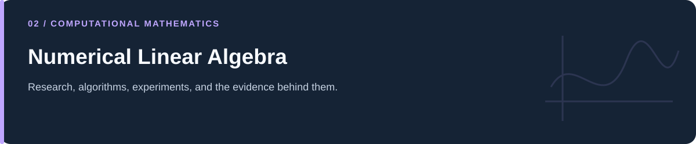

# Numerical Linear Algebra

**Linear systems, roundoff, orthogonality, iteration, and least squares.**

[Portfolio](../README.md) · [Evidence & results](../docs/PROJECT_EVIDENCE.md) · [2026 repairs](../docs/REPAIRS.md) · [Reproduction](../docs/REPRODUCIBILITY.md) · [Full code catalog](../docs/CODE_CATALOG.md)

---

## At a glance

| Item | Description |
|---|---|
| Collection | Numerical Linear Algebra |
| Subject source inventory | 15 Python · 0 R · 0 notebooks |
| Verification level | Source inspection, selected saved artifacts, and focused regressions described in the repair log. |

## Scope and interpretation

Read the chosen matrix and stopping criterion along with each algorithm. Small illustrative systems demonstrate a computation; they are not benchmarks across all matrix classes. The CGS projection correction changes the current experiment, while original figures remain historical.

## A useful reading route

| Stage | Mathematical focus | Evidence to inspect |
|---|---|---|
| Direct solves | Elimination, pivots, and LU | Input matrices and row operations. |
| Iterative solves | Jacobi, power iteration, CG, steepest descent | Stopping tests, residuals, iterates, and matrix spectrum. |
| Orthogonalization | Classical and modified Gram–Schmidt | Q/R reconstruction and loss of orthogonality. |
| Overdetermined systems | Least squares, normal equations, SVD pseudoinverse | Rank, residual norm, and solution differences. |
| Error behavior | Heron's method and ill-conditioning | Absolute/relative errors and plotting scales. |

*Preserved CG path for the specific 2×2 system. Exact-fraction and float calculations are implemented in the source; the image was not regenerated during documentation work.*

## Project and study guides

| Guide | Question |
|---|---|
| [Conjugate Gradient: Exact and Floating Arithmetic](Conjugate%20Gradient%20Method-Exact%20vs%20Floating-Point%20Performance%20on%20a%202%C3%972%20Linear%20System/README.md) | What changes when the same small CG computation uses fractions or float64? |
| [Gaussian Elimination and LU](Gaussian%20elimination/README.md) | How are linear systems reduced and factored? |
| [Classical and Modified Gram–Schmidt](Gram-Schmidt%20and%20Modified%20Gram-Schmidt%20process/README.md) | How do projection order and finite precision affect an orthogonal basis? |
| [Heron's Square-Root Iteration](Heron%27s%20method-sqrt%28S%29/README.md) | How does a square-root iterate approach its target from different initial guesses? |
| [Jacobi Iteration and Spectral Radius](Jacobi%20Method%20%E2%80%94%20Iteration%20Matrix%2C%20Spectral%20Radius%2C%20and%20Convergence/README.md) | How do the iteration matrix, residual, and actual error relate? |
| [Least Squares and the Pseudoinverse](Least-Squares%20and%20Pseudo-Inverse%20for%20an%20Overdetermined%20System/README.md) | How do several constructions solve the same overdetermined system? |
| [Power Iteration Examples](Power%20Method%20-%20finding%20%28largest%29%20eigenvalue/README.md) | How does repeated matrix multiplication reveal a dominant eigen-direction? |
| [Conditioning and Matrix Geometry](Some%20projects/Some%20projects/README.md) | What can a small numerical experiment show about ill-conditioning? |
| [Iterative Linear-System Variants](nxn%20system%20numerical%20solution/README.md) | How is a Jacobi iteration organized for concrete n×n examples? |

## Reading and execution

Start with the guide matching your question, inspect its parameters and inputs, then follow links to source. The order is an explanatory reading path; it is not a guarantee that every script executes consecutively.

Read [the reproduction guide](../docs/REPRODUCIBILITY.md) before running code. Source files can load external data, contact services, write artifacts, run large searches, or control hardware. The focused validation suite does not reproduce all historical experiments.

---

[Portfolio](../README.md) · [Evidence & results](../docs/PROJECT_EVIDENCE.md) · [2026 repairs](../docs/REPAIRS.md) · [Reproduction](../docs/REPRODUCIBILITY.md) · [Full code catalog](../docs/CODE_CATALOG.md)
