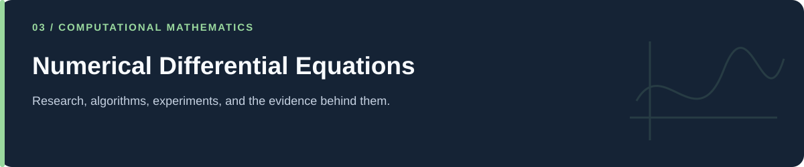

# Numerical Differential Equations

**Discretized operators, next-generation matrices, and nonlinear phase portraits.**

[Portfolio](../README.md) · [Evidence & results](../docs/PROJECT_EVIDENCE.md) · [2026 repairs](../docs/REPAIRS.md) · [Reproduction](../docs/REPRODUCIBILITY.md) · [Full code catalog](../docs/CODE_CATALOG.md)

---

## At a glance

| Item | Description |
|---|---|
| Collection | Numerical Differential Equations |
| Subject source inventory | 18 Python · 0 R · 0 notebooks |
| Verification level | Source inspection, selected saved artifacts, and focused regressions described in the repair log. |

## Scope and interpretation

The 800-group examples use prescribed contact, population, smoothing, and recovery assumptions. The repaired population grouping is consistent with the companion eight-band examples. Old CSVs and figures were retained and have not been regenerated from the corrected code.

## Project and study guides

| Guide | Question |
|---|---|
| [Next-Generation Matrices and Age Aggregation](Age%20str%20R_0%20compuation-Numerical%20method%20for%20NxN%20matrix/README.md) | How do contact, population, and recovery assumptions feed a spectral-radius calculation? |
| [Discrete Diffusion Operators](Parabolic%20PDE%28Diffiusion%20Equation%29/README.md) | What does an iteration operator reveal about one diffusion discretization? |
| [Nonlinear Second-Order Phase Portraits](Second%20order%20non-linear%20Equation/README.md) | How do parameter choices change the vector field of the chosen system? |

## Reading and execution

Start with the guide matching your question, inspect its parameters and inputs, then follow links to source. The order is an explanatory reading path; it is not a guarantee that every script executes consecutively.

Read [the reproduction guide](../docs/REPRODUCIBILITY.md) before running code. Source files can load external data, contact services, write artifacts, run large searches, or control hardware. The focused validation suite does not reproduce all historical experiments.

---

[Portfolio](../README.md) · [Evidence & results](../docs/PROJECT_EVIDENCE.md) · [2026 repairs](../docs/REPAIRS.md) · [Reproduction](../docs/REPRODUCIBILITY.md) · [Full code catalog](../docs/CODE_CATALOG.md)
