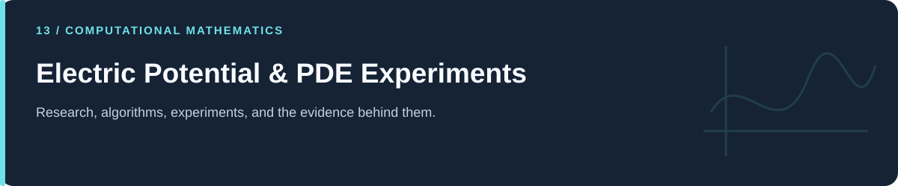

# Electric Potential & PDE Experiments

**Finite differences and boundary scenarios for an illustrative potential field.**

[Portfolio](../README.md) · [Evidence & results](../docs/PROJECT_EVIDENCE.md) · [2026 repairs](../docs/REPAIRS.md) · [Reproduction](../docs/REPRODUCIBILITY.md) · [Full code catalog](../docs/CODE_CATALOG.md)

---

## At a glance

| Item | Description |
|---|---|
| Collection | Electric Potential & PDE Experiments |
| Subject source inventory | 3 Python · 0 R · 0 notebooks |
| Verification level | Source inspection, selected saved artifacts, and focused regressions described in the repair log. |

## Scope and interpretation

The representative script updates potential values in place, making the sweep Gauss–Seidel-like. A saved field is not evidence of a calibrated physical lightning model or of a coupled stochastic growth algorithm.

## Project and study guides

| Guide | Question |
|---|---|
| [Potential-Field Boundary Scenarios](Lightening%20Modeling/README.md) | How do boundary values change a grid-based electric potential? |

## Reading and execution

Start with the guide matching your question, inspect its parameters and inputs, then follow links to source. The order is an explanatory reading path; it is not a guarantee that every script executes consecutively.

Read [the reproduction guide](../docs/REPRODUCIBILITY.md) before running code. Source files can load external data, contact services, write artifacts, run large searches, or control hardware. The focused validation suite does not reproduce all historical experiments.

---

[Portfolio](../README.md) · [Evidence & results](../docs/PROJECT_EVIDENCE.md) · [2026 repairs](../docs/REPAIRS.md) · [Reproduction](../docs/REPRODUCIBILITY.md) · [Full code catalog](../docs/CODE_CATALOG.md)
