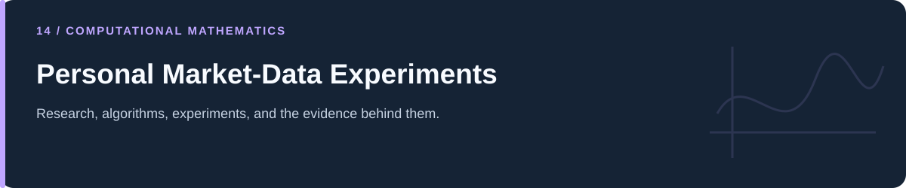
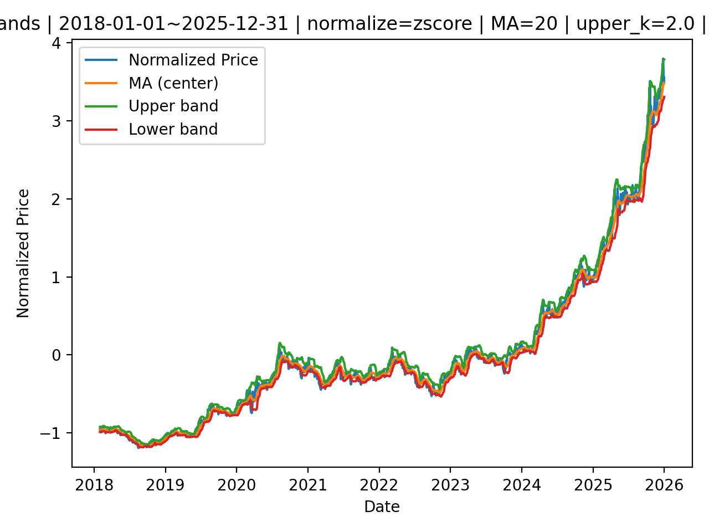

# Personal Market-Data Experiments

**Historical equity notebooks, R probability studies, and a gold-data pipeline.**

[Portfolio](../README.md) · [Evidence & results](../docs/PROJECT_EVIDENCE.md) · [2026 repairs](../docs/REPAIRS.md) · [Reproduction](../docs/REPRODUCIBILITY.md) · [Full code catalog](../docs/CODE_CATALOG.md)

---

## At a glance

| Item | Description |
|---|---|
| Collection | Personal Market-Data Experiments |
| Subject source inventory | 2 Python · 13 R · 5 notebooks |
| Verification level | Source inspection, selected saved artifacts, and focused regressions described in the repair log. |

## Scope and interpretation

This guide covers committed artifacts. Separate uncommitted mean-reversion/streaming extensions remain in the owner's original working folder and are not included in this publication. No profitability or live trading operation is established by these exploratory analyses.

## Committed gold-data pipeline

| Stage | Source | Observed behavior |
|---|---|---|
| Fetch | [01_fetch_gold_data.py](01_fetch_gold_data.py) | yfinance download; default `GC=F`; Date/Price CSV; CLI-configurable dates/output. |
| Features | [02_build_bands_and_plots.py](02_build_bands_and_plots.py) | Date filtering, full-window normalization, 20-observation moving mean/std, asymmetric upper/lower bands. |
| Visuals | Existing `figures/` | Full-window and zoomed historical band plots. |

*Original committed figure. The original working copy contains a newer local plotting variant and additional mean-reversion drafts; those pre-existing uncommitted files were preserved and are not silently included here.*

Full-window normalization uses information from the chosen analysis interval. Descriptive band plots and historical preference rankings do not establish a deployable or independently tested strategy. No market-data fetch, brokerage connection, or order was made for this task.

## Project and study guides

| Guide | Question |
|---|---|
| [Market Direction and Probability Studies in R](stock_market_probability/README.md) | How are returns, runs, and conditional market summaries explored? |
| [Historical Equity Recommendation and Earnings Notebooks](stock_market_project/README.md) | How are market deviations, preferences, EPS, and P/E tables explored? |

## Reading and execution

Start with the guide matching your question, inspect its parameters and inputs, then follow links to source. The order is an explanatory reading path; it is not a guarantee that every script executes consecutively.

Read [the reproduction guide](../docs/REPRODUCIBILITY.md) before running code. Source files can load external data, contact services, write artifacts, run large searches, or control hardware. The focused validation suite does not reproduce all historical experiments.

---

[Portfolio](../README.md) · [Evidence & results](../docs/PROJECT_EVIDENCE.md) · [2026 repairs](../docs/REPAIRS.md) · [Reproduction](../docs/REPRODUCIBILITY.md) · [Full code catalog](../docs/CODE_CATALOG.md)
