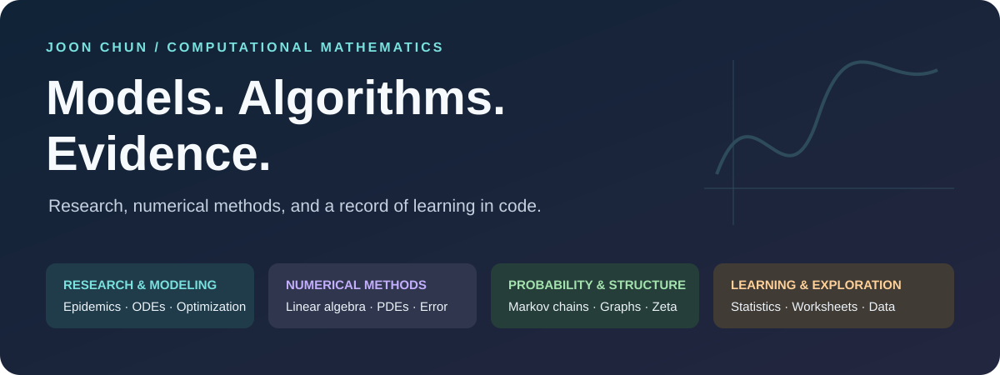

<p align="center"></p>

<h1 align="center">Computational Mathematics Portfolio</h1>

<p align="center"><b>Research · Numerical Algorithms · Probability · Statistical Learning</b><br>A collection by Joon Chun, connecting mathematical questions with inspectable code.</p>

<p align="center"><a href="#featured-work">Featured work</a> · <a href="#collection-index">All collections</a> · <a href="#how-to-read-this-repository">Start reading</a> · <a href="docs/REPAIRS.md">Repairs &amp; validation</a> · <a href="docs/REPRODUCIBILITY.md">Reproduction guide</a></p>

---

## About this portfolio

This repository brings together mathematical research, coursework, teaching-oriented materials, and exploratory projects. Its roots include my M.S. work at California State University, Los Angeles, with later numerical and statistical experiments also preserved here.

The central theme is to turn a mathematical question into an explicit model or algorithm, inspect its assumptions, and use numerical evidence carefully. The archive includes **16 subject collections, 287 Python files, 14 R files, and five notebooks**, including a checkpoint. These counts describe subject artifacts; maintainer tools and tests are listed separately.

> **Evidence matters:** a published article, an archived output, and a freshly tested implementation establish different things. The guides distinguish those states and identify newly completed 2026 reference examples. Full historical experiments have not all been rerun.

## Featured work

| Project or study | Question and approach | Explore |
|---|---|---|
| **Age-structured epidemic interventions** | Combine compartmental ODEs, transmission fitting, intervention scenarios, and economic accounting. Related coauthored research is published in Spora (2026). | [Research guide](Mathematical%20Modeling/Thesis%20modeling%20-%20epidemics%20and%20politics%20of%20public%20health/README.md) |
| **Numerical linear algebra** | Examine matrix solves, iteration, exact versus floating arithmetic, orthogonality, and least squares. | [Algorithms & figures](Numerical%20Linear%20Algebra/README.md) |
| **Zeta zero statistics** | Locate numerical zeros and inspect gap histograms, normalization, and comparison curves. | [Study & limitations](Zeta%20function%20and%20zeros/README.md) |
| **Network construction** | Explore Prim/Kruskal methods, road-cost examples, and reciprocal-volume trade graphs. | [Networks & animations](Minimum_Spanning_Tree_Problem/README.md) |
| **Nearest-neighbor geometry** | Study synthetic 1-NN error at a fixed target as dimension grows. | [Simulation guide](Mathematical%20and%20Statistical%20Data%20Science/README.md) |
| **Learning from simple models** | Connect hand-designed scores, hidden nodes, grid searches, gradient ideas, and descriptive data exploration. | [Worksheets & code](Mini-projects/README.md) |

### Research connected to a publication

The journal's official record lists Joon Chun and Melisa Hendrata's age-structured SIRVD intervention study in **Spora 12, 17–28 (2026)**, DOI **10.61403/2473-5493.1113**. The linked research guide explains how the thesis-era scripts, SPORA revisions, saved scenarios, and new accounting reference differ. [Journal record](https://ir.library.illinoisstate.edu/spora/vol12/iss1/2/).

<table><tr><td width="50%" align="center"><p align="center"></p><sub>Research: a preserved model-fitting comparison</sub></td><td width="50%" align="center"><p align="center"></p><sub>Learning: a preserved Monte Carlo error study</sub></td></tr></table>

*Original archived figures, retained without retouching. They illustrate their specific experiments; the documentation update did not recompute them.*

## Collection index

| Collection | What you will find |
|---|---|
| [Mathematical Modeling](Mathematical%20Modeling/readme.md) | From compartment models to age-specific intervention and economic scenarios. |
| [Numerical Linear Algebra](Numerical%20Linear%20Algebra/README.md) | Linear systems, roundoff, orthogonality, iteration, and least squares. |
| [Numerical Differential Equations](Numerical%20method%20for%20ODEs_PDEs/README.md) | Discretized operators, next-generation matrices, and nonlinear phase portraits. |
| [Numerical Analysis Team Projects](Team_Projects/README.md) | From root finding and quadrature to initial- and boundary-value problems. |
| [Zeta Functions & Zero Statistics](Zeta%20function%20and%20zeros/README.md) | Complex-function experiments, numerical roots, spacings, and comparison curves. |
| [Complex Analysis](Complex%20analysis/README.md) | Series tests, branch cuts, and sequences of functions in computational form. |
| [Markov Chains & Random Walks](Markov%20chain%20Modeling/README.md) | Transition sampling, Monte Carlo experiments, and animated paths. |
| [Markov Chain Worked Exercises](Markov%20chain%20textbook%20Qs%20practices/README.md) | Matrix powers, distributions, expectations, and spectral calculations. |
| [Minimum Spanning Trees & Networks](Minimum_Spanning_Tree_Problem/README.md) | Road-cost examples, graph algorithms, and exploratory trade networks. |
| [Mathematical & Statistical Data Science](Mathematical%20and%20Statistical%20Data%20Science/README.md) | Nearest-neighbor geometry, dimensionality, and error decomposition. |
| [Machine Learning Mini-Projects](Mini-projects/README.md) | Worksheets and code connecting hand-built rules to learning and evaluation. |
| [Public Data API Workflows](Data%20base%20OpenAPI/README.md) | Historical Korean COVID-19 collection, grouping, and data correction scripts. |
| [Electric Potential & PDE Experiments](PDEs%20and%20Markov%20chain%20Modeling/README.md) | Finite differences and boundary scenarios for an illustrative potential field. |
| [Personal Market-Data Experiments](Personal_Projects/README.md) | Historical equity notebooks, R probability studies, and a gold-data pipeline. |
| [Robotics: Tello Control Examples](Robotics/README.md) | Basic connection, battery checks, takeoff/landing, and camera experiments. |
| [Small Mathematical Utilities](Simple%20Math%20code/README.md) | Exact fractions, probability arithmetic, and matrix multiplication. |

## How to read this repository

- **For a portfolio review:** start with the featured work, then read a collection overview and its detailed study guides.
- **For a technical review:** open the linked source and compare the evidence register, assumptions, and repair record.
- **For a new run:** begin with the reproduction guide. Check data, paths, parameters, external effects, and output destinations before executing code.

The root introduces the work, collection READMEs map the topics, detailed guides explain individual studies, and the complete catalog links all **306 subject source artifacts**. Original folder names and historical versions remain in place.

```text
My_projects/
├── README.md                         # Portfolio entry point
├── Mathematical Modeling/            # Epidemics and other dynamical systems
├── Numerical Linear Algebra/         # Matrix algorithms and error behavior
├── Team_Projects/                    # Collaborative numerical coursework
├── ...                              # Other subject collections indexed above
├── assets/readme/                    # Authored vector covers and provenance
├── docs/                             # Evidence, repairs, reproduction, catalog
├── tests/                            # Focused mathematical regressions
├── tools/                            # Documentation builder and static checks
└── memory/                           # Maintainer continuity records
```

## Code completion and verification

The October 2026 repair pass completed four former comment-only files and corrected identified syntax, name, equation-flow, indexing, statistical-API, and numerical-scheme issues. Regression checks use conservation laws, analytical solutions, known integrals, and controlled fixtures. See the [repair record](docs/REPAIRS.md) for the exact changes and verification boundary.

```powershell
python -m pip install -r requirements-validation.txt
python tools/validate_repository.py
python -m ruff check --select E9,F821,F822,F823 .
python -m pytest tests/test_repairs.py -q
```

These commands validate the stated maintenance scope. They do not restore every historical data source, train every model, connect to services, or operate a drone. The [reproduction guide](docs/REPRODUCIBILITY.md) lists collection-specific preparation.

## Credits, provenance, and archive status

Research coauthorship, the team-project setting, script-level references, and preserved worksheets are identified where evidence supports them. A file's presence is not a claim of sole authorship of all ideas or third-party data. No new repository-wide software/data license is declared by this update.

- [Project evidence and saved outcomes](docs/PROJECT_EVIDENCE.md)
- [Completed files, corrections, and validation](docs/REPAIRS.md)
- [Data and execution preparation](docs/REPRODUCIBILITY.md)
- [Complete source catalog](docs/CODE_CATALOG.md)
- [Presentation asset provenance](assets/readme/SOURCES.md)

Documentation and repairs reviewed on **2026-10-20**. Historical outputs are preserved and labeled; original uncommitted work remains separate from the published change.
