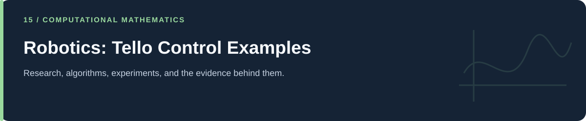

# Robotics: Tello Control Examples

**Basic connection, battery checks, takeoff/landing, and camera experiments.**

[Portfolio](../README.md) · [Evidence & results](../docs/PROJECT_EVIDENCE.md) · [2026 repairs](../docs/REPAIRS.md) · [Reproduction](../docs/REPRODUCIBILITY.md) · [Full code catalog](../docs/CODE_CATALOG.md)

---

## At a glance

| Item | Description |
|---|---|
| Collection | Robotics: Tello Control Examples |
| Subject source inventory | 3 Python · 0 R · 0 notebooks |
| Verification level | Source inspection, selected saved artifacts, and focused regressions described in the repair log. |

## Scope and interpretation

These scripts have real hardware effects at top level. Do not import or execute them as smoke tests. Static inspection does not establish successful or safe flight; no drone was connected during this work.

## Project and study guides

| Guide | Question |
|---|---|
| [Tello Battery, Flight, and Camera Examples](Basic%20Drone%20contraks/Basic%20Drone%20contraks-DJI%20EDU/README.md) | What does the preserved script actually send to the drone? |

## Reading and execution

Start with the guide matching your question, inspect its parameters and inputs, then follow links to source. The order is an explanatory reading path; it is not a guarantee that every script executes consecutively.

Read [the reproduction guide](../docs/REPRODUCIBILITY.md) before running code. Source files can load external data, contact services, write artifacts, run large searches, or control hardware. The focused validation suite does not reproduce all historical experiments.

---

[Portfolio](../README.md) · [Evidence & results](../docs/PROJECT_EVIDENCE.md) · [2026 repairs](../docs/REPAIRS.md) · [Reproduction](../docs/REPRODUCIBILITY.md) · [Full code catalog](../docs/CODE_CATALOG.md)
