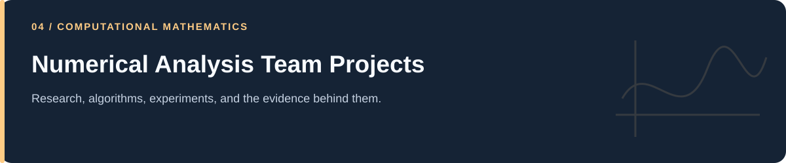

# Numerical Analysis Team Projects

**From root finding and quadrature to initial- and boundary-value problems.**

[Portfolio](../README.md) · [Evidence & results](../docs/PROJECT_EVIDENCE.md) · [2026 repairs](../docs/REPAIRS.md) · [Reproduction](../docs/REPRODUCIBILITY.md) · [Full code catalog](../docs/CODE_CATALOG.md)

---

## At a glance

| Item | Description |
|---|---|
| Collection | Numerical Analysis Team Projects |
| Subject source inventory | 52 Python · 0 R · 0 notebooks |
| Verification level | Source inspection, selected saved artifacts, and focused regressions described in the repair log. |

## Scope and interpretation

The folder records team-project work; specific collaborator identities and individual task ownership are not established by the reviewed files. This documentation explains the preserved implementations without assigning sole authorship of the entire collection.

## Two complementary paths

| Path | Topics | What connects them |
|---|---|---|
| Numerical-analysis foundations | Root finding, tabulated/function quadrature, least squares | Approximation, error measures, and finite calculations. |
| Differential-equation methods | IVPs, coupled SIR ODEs, BVP/Jacobi, forced diffusion | Translating a continuous problem into an iterative computation. |

The detailed guides identify actual formulas, parameters, and reading order. The repair record explains the corrected Simpson study, safeguarded hybrid solver, BVP forcing sign, and Crank–Nicolson source scaling.

## Project and study guides

| Guide | Question |
|---|---|
| [Boundary Values and Jacobi Iteration](Numerical%20Methods%20for%20ODEs%2C%20PDEs%20and%20Linear%20Algebra/Boundary%20Value%20Problem%20%26%20the%20Jacobi%20Method/README.md) | How is a two-endpoint boundary problem converted into a tridiagonal solve? |
| [Differentiation, Quadrature, and Error Order](Numerical%20Methods%20for%20ODEs%2C%20PDEs%20and%20Linear%20Algebra/Numerical%20Differentiation%20and%20Integration%20with%20Big%20O/README.md) | How does mesh refinement change an approximation error? |
| [Initial-Value Problems and Error Studies](Numerical%20Methods%20for%20ODEs%2C%20PDEs%20and%20Linear%20Algebra/Numerical%20Solution%20for%20First-order%20IVP%20with%20Big%20O/README.md) | How can a known solution help examine time-stepping accuracy? |
| [Solar-Pond Diffusion and Crank–Nicolson](Numerical%20Methods%20for%20ODEs%2C%20PDEs%20and%20Linear%20Algebra/Parabolic%20PDEs%20-%20Crank-Nicolson%20scheme/README.md) | How can a forced diffusion equation be stepped implicitly? |
| [SIR Systems and Predictor–Corrector Methods](Numerical%20Methods%20for%20ODEs%2C%20PDEs%20and%20Linear%20Algebra/System%20of%20ODEs%20by%20numerical%20method-SIR%20model/README.md) | How can a coupled SIR model be advanced without a black-box integrator? |
| [Interpolation, Least Squares, and Numerical Integration](Numerical_analysis/Numerical_interpolation/README.md) | How do tabulated data and analytic functions lead to numerical estimates? |
| [Root Finding and a Can-Design Example](Numerical_analysis/Numerical_root_finding/README.md) | How can bisection and secant steps be combined on a bracket? |

## Reading and execution

Start with the guide matching your question, inspect its parameters and inputs, then follow links to source. The order is an explanatory reading path; it is not a guarantee that every script executes consecutively.

Read [the reproduction guide](../docs/REPRODUCIBILITY.md) before running code. Source files can load external data, contact services, write artifacts, run large searches, or control hardware. The focused validation suite does not reproduce all historical experiments.

---

[Portfolio](../README.md) · [Evidence & results](../docs/PROJECT_EVIDENCE.md) · [2026 repairs](../docs/REPAIRS.md) · [Reproduction](../docs/REPRODUCIBILITY.md) · [Full code catalog](../docs/CODE_CATALOG.md)
