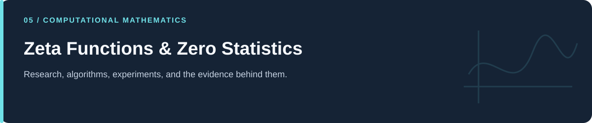
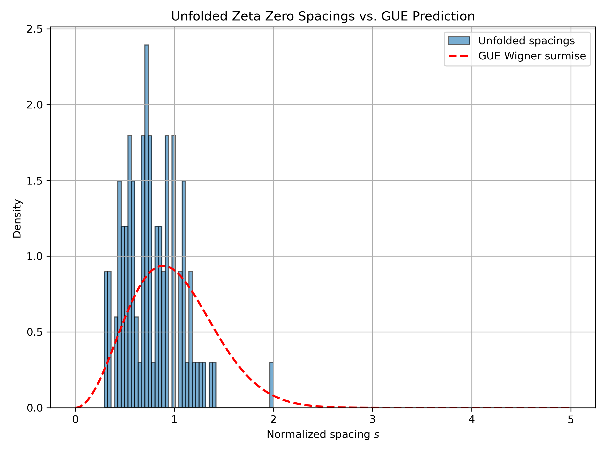

# Zeta Functions & Zero Statistics

**Complex-function experiments, numerical roots, spacings, and comparison curves.**

[Portfolio](../README.md) · [Evidence & results](../docs/PROJECT_EVIDENCE.md) · [2026 repairs](../docs/REPAIRS.md) · [Reproduction](../docs/REPRODUCIBILITY.md) · [Full code catalog](../docs/CODE_CATALOG.md)

---

## At a glance

| Item | Description |
|---|---|
| Collection | Zeta Functions & Zero Statistics |
| Subject source inventory | 19 Python · 0 R · 0 notebooks |
| Verification level | Source inspection, selected saved artifacts, and focused regressions described in the repair log. |

## Scope and interpretation

Finite samples and graphics are exploratory. They do not prove a conjecture. The GUE KS diagnostic now compares spacings to a CDF; dependence and unfolding choices still limit inferential interpretation.

## Three questions, three different numerical summaries

| Experiment | What it computes | Interpretation boundary |
|---|---|---|
| `(1.1.2)` | Roots near prescribed starting guesses; raw consecutive gaps; an exponential KS diagnostic. | Root finding needs order/uniqueness checks; a fitted-mean comparison is not a proof of a spacing law. |
| `(1.2.1)` | Gaps divided by their running average, plotted against a GUE Wigner surmise density. | This running normalization differs from a fully justified unfolding analysis. |
| `(1.3.1)` | First 100 `mp.zetazero` values; normalized gaps and all positive pair distances. | A density-normalized distance histogram is not automatically on the standard pair-correlation scale. |

The repaired `(1.2.1)` diagnostic uses a one-sample KS comparison of observed normalized gaps with the plotted distribution's CDF. The former version passed empirical/theoretical CDF ordinate arrays to `ks_2samp`. SciPy specifies two samples of observations for that function; the API distinction is documented in the [repair record](../docs/REPAIRS.md). [SciPy reference](https://docs.scipy.org/doc/scipy/reference/generated/scipy.stats.ks_2samp.html).

*Original stored comparison figure. The source's KS calculation is corrected; this historical image is preserved. No newly estimated p-value is claimed here.*

## Start reading

Begin with the numbered zero-statistics scripts, then inspect the functional-equation and parameterized-function experiments. Keep finite numerical evidence separate from statements about all zeta zeros.

## Source guide

| Source | What to inspect |
|---|---|
| [(1.1.2)Riemann Zeta Nontrivial Zeros & Spacing Analysis (KS Test).py](%281.1.2%29Riemann%20Zeta%20Nontrivial%20Zeros%20%26%20Spacing%20Analysis%20%28KS%20Test%29.py) | Defined helpers: `find_zero_near` |
| [(1.2.1)Unfolded Zeta Zero Spacings vs. GUE Wigner Surmise.py](%281.2.1%29Unfolded%20Zeta%20Zero%20Spacings%20vs.%20GUE%20Wigner%20Surmise.py) | Defined helpers: `find_zero_near`, `p_gue`, `gue_cdf` |
| [(1.3.1)Two-Point Correlation of Unfolded Riemann Zeta Zeros vs. GUE Prediction.py](%281.3.1%29Two-Point%20Correlation%20of%20Unfolded%20Riemann%20Zeta%20Zeros%20vs.%20GUE%20Prediction.py) | Defined helpers: `R2_gue` |
| [(Functional)Zeta function with two parameter functions.py](%28Functional%29Zeta%20function%20with%20two%20parameter%20functions.py) | Defined helpers: `generate_complex_inputs`, `zeta_functional_equation_rhs`, `plot_results_multi` |
| [(Functional)Zeta function-functional equation.py](%28Functional%29Zeta%20function-functional%20equation.py) | Defined helpers: `zeta_functional_equation_rhs` |
| [(Functional)Zeta function-several zeros.py](%28Functional%29Zeta%20function-several%20zeros.py) | Defined helpers: `zeta_functional_equation_rhs` |
| [Pointwise - Uniform Convergence.py](Pointwise%20-%20Uniform%20Convergence.py) | Top-level experiment; imports: matplotlib.pyplot, numpy, pandas |
| [Pointwise Convergence.py](Pointwise%20Convergence.py) | Top-level experiment; imports: matplotlib.pyplot, numpy, pandas |
| [Riemann–von Mangoldt explicit formula.py](Riemann%E2%80%93von%20Mangoldt%20explicit%20formula.py) | Defined helpers: `explicit_psi`, `psi`, `prime_sieve` |
| [Uniform Convergence.py](Uniform%20Convergence.py) | Top-level experiment; imports: matplotlib.pyplot, numpy, pandas |
| [Uniform Convergence2.py](Uniform%20Convergence2.py) | Top-level experiment; imports: matplotlib.pyplot, numpy, pandas |
| [Zeta function in series.py](Zeta%20function%20in%20series.py) | Defined helpers: `zeta`, `plot_results`, `main` |
| [Zeta function vector addition idea.py](Zeta%20function%20vector%20addition%20idea.py) | Defined helpers: `partial_sums_zeta`, `plot_input_and_vectors`, `main` |
| [Zeta function with parameter functions zeta(lambda(t)).py](Zeta%20function%20with%20parameter%20functions%20zeta%28lambda%28t%29%29.py) | Defined helpers: `generate_complex_inputs`, `zeta`, `plot_results`, `main` |
| [Zeta function with two parameter functions.py](Zeta%20function%20with%20two%20parameter%20functions.py) | Defined helpers: `generate_complex_inputs`, `zeta`, `plot_results_multi`, `main` |
| [p1.py](p1.py) | Defined helpers: `approximate_zero_count`, `unfold_zeros`, `compute_unfolded_spacings` |
| [p2.py](p2.py) | Defined helpers: `compute_unfolded_spacings` |
| [unfolded_zeros.py](unfolded_zeros.py) | Defined helpers: `zeta_half_it`, `find_zero_near`, `approximate_zero_count` |
| [zeta zeors finding algorithm.py](zeta%20zeors%20finding%20algorithm.py) | Defined helpers: `zeta_half_it`, `find_zero_near`, `initial_guess`, `approx_count` |

## Reading and execution

Start with the guide matching your question, inspect its parameters and inputs, then follow links to source. The order is an explanatory reading path; it is not a guarantee that every script executes consecutively.

Read [the reproduction guide](../docs/REPRODUCIBILITY.md) before running code. Source files can load external data, contact services, write artifacts, run large searches, or control hardware. The focused validation suite does not reproduce all historical experiments.

---

[Portfolio](../README.md) · [Evidence & results](../docs/PROJECT_EVIDENCE.md) · [2026 repairs](../docs/REPAIRS.md) · [Reproduction](../docs/REPRODUCIBILITY.md) · [Full code catalog](../docs/CODE_CATALOG.md)
